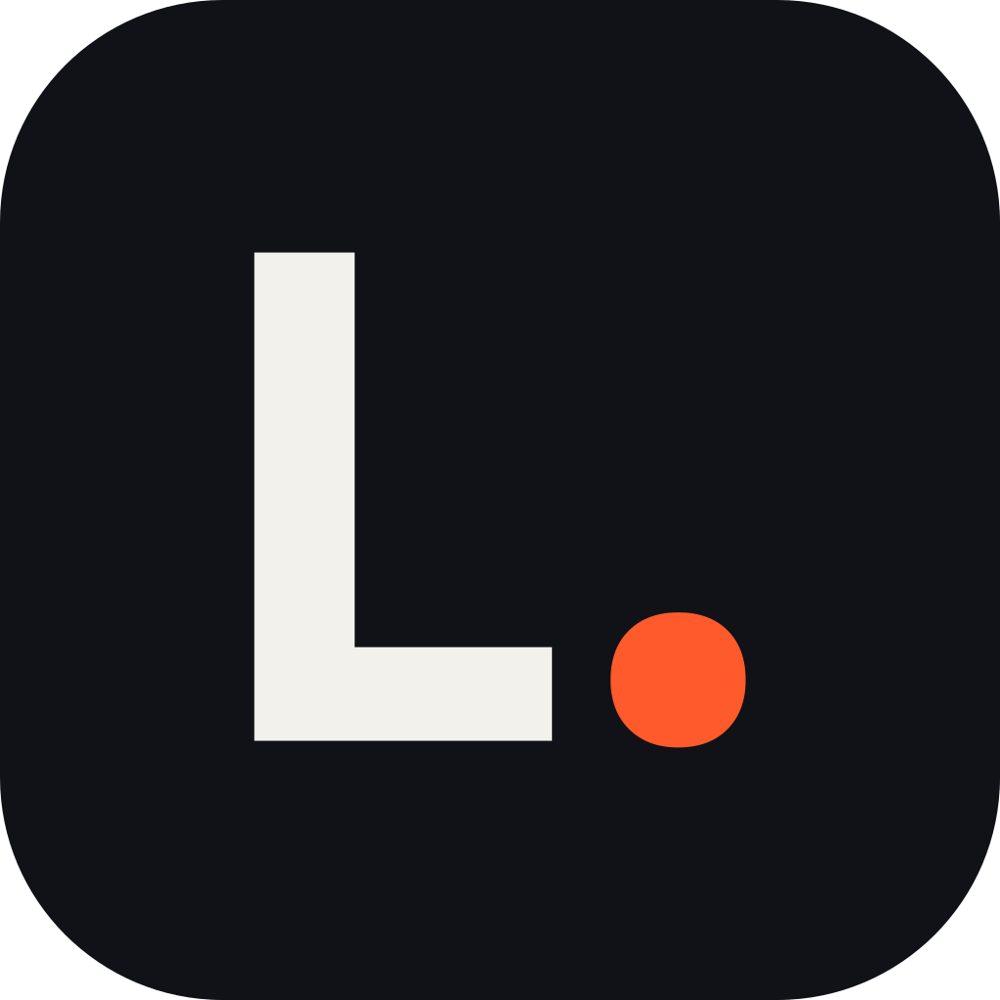

# Leve

A workout tracker for iPhone with routines, workout history, and progress charts.

## Try the developer preview

Run Leve in a browser with sample workouts using the versions of Node.js and pnpm specified in
[`.node-version`](.node-version) and [`package.json`](package.json).

```sh
pnpm install --frozen-lockfile
pnpm preview:web
```

Open `http://127.0.0.1:41788`. For development on an iPhone or simulator, use `pnpm dev:app`
and follow the [mobile app guide](apps/mobile/README.md).

## Project status

The iPhone app stores workouts on the device. Sync runs on the
[Cloudflare sync server](apps/sync-cloudflare/README.md) or on a
[Node sync server you host yourself](apps/sync-node/README.md), which has its own accounts and
paired phones; the app can't connect to one yet. Both are development
previews: use disposable data in an environment you control. Hevy CSV import and MCP access are
planned.

[Contributing](CONTRIBUTING.md) · [Security](SECURITY.md) · [Licenses](LICENSE.md) · [Branding](TRADEMARKS.md)
